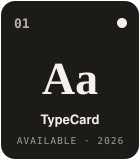
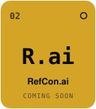
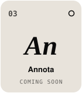
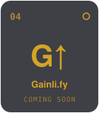
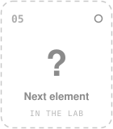

  

<h1 align="center">JustReal</h1>

  <b>We're not against AI. We're against how it's being used.</b> 
  Just real apps for real users.

 

##  Projects Table

Every project is made with care and understood down to the last line.

  
  
  
  
  

● available &nbsp;·&nbsp; ○ in progress

| No. | Element | What it does | Status |
| --- | --- | --- | --- |
| 01 | [**TypeCard**](https://typecard.justreal.es) | Generate typography specimens in seconds. | Available |
| 02 | **RefCon.ai** | Coming soon. | In progress |
| 03 | **Annota** | Coming soon. | In progress |
| 04 | **Gainli.fy** | Coming soon. | In progress |

## Our rules

1. **We only use AI for work we already know how to do.** If you can't fully understand what an AI gives you, you haven't done anything.
2. **AI has a real cost.** Electricity, water, environmental impact, and our own ability to think. We don't spend it lightly.
3. **Saving time means doing more, not less.** A tool that saves you hours is a reason to build better things, not an excuse to stop working.

## Why

Too many people think with a chatbot instead of their own head. Behind every useful result there's a human who understands it. That's what we want to be.

We are not the product. We are the creators — and the users.

## Contact

[justreal-dev@proton.me](mailto:justreal-dev@proton.me)